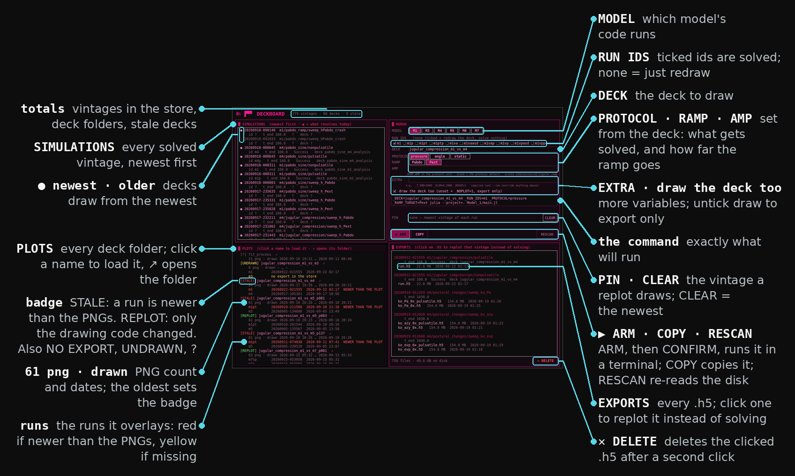

# Deckboard

What has been solved, what has been drawn, and which is stale — for the brainphysio
human family (M1–M7).

One window over two trees that nothing else joins: the simulation store
(`simulations/<model>/<experiment>/<variant>/<stamp>/run.h5`) and the deck folders
(`modelplots/<deck>/*.png`). For every deck it resolves the runs that deck overlays,
compares their exports and the code that draws them against the PNGs, and gives you
the command that brings the deck up to date — a replot when only the drawing code
moved, a solve when the runs did. The command runs in a new terminal; nothing is
launched from the window itself.

The header of `deckboard.py` explains every design decision at length.

## The window

The left half is what is on disk: every solved vintage, and every deck folder with its
verdict. The right half builds the command that brings a deck up to date, and lists the
exports it can replot instead of solving.



## Getting it

Deckboard is a git submodule of the brainphysio repo, at `deckboard/`, on the
`human_m123` branch:

```bash
git clone --recursive <brainphysio repo>          # a fresh clone
git submodule update --init deckboard             # an existing clone, on human_m123
```

A plain clone does not fetch it, which is the point: the handover repo does not
carry it.

## Running it

From the root of the brainphysio checkout:

```bash
python3 deckboard/deckboard.py              # the window
python3 deckboard/deckboard.py --report     # the same data as text, no window
python3 deckboard/deckboard.py --selftest   # build the window, render one frame, exit
python3 deckboard/deckboard.py --repo PATH  # read another checkout (a worktree, a clone)
```

The window needs tkinter, a separate package on Debian/Ubuntu:
`sudo apt install python3-tk`. `--report` needs nothing but the standard library.
